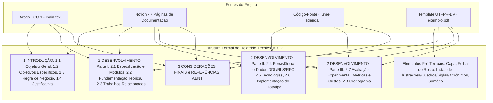

# Plano Mestre de Estruturação — Relatório Técnico TCC 2 (Lume Agenda)

**Instituição:** Universidade Tecnológica Federal do Paraná (UTFPR) — Campus Dois Vizinhos  
**Curso:** Bacharelado em Engenharia de Software  
**Autora:** Gabriella Marreto Rodrigues  
**Orientador:** Prof. Dr. Evandro Kuszera  
**Título do Trabalho:** Uma Arquitetura Cache-First para Aplicações PWA de Agendamento em Larga Escala Focada no Microempreendedor  
**Repositório do Produto (Implementação):** `lume-agenda`  
**Repositório do Relatório (LaTeX):** `tcc2-relatorio` (`Artigo___PWA/main.tex`)  

---

## 1. Visão Geral e Diagnóstico das Fontes Analisadas

Este documento consolida o planejamento estrutural e de conteúdo para o **Relatório Técnico de TCC 2**, resultante do cruzamento de quatro fontes principais:
1. **Artigo de TCC 1 (`Artigo___PWA/main.tex`):** Base textual inicial contendo a problematização dos Microempreendedores Individuais (MEIs), visão geral da arquitetura *Cache-First*, resumo de requisitos, protótipo inicial e cronograma.
2. **Modelo de Relatório Técnico UTFPR-DV (`exemplo.pdf`):** Padrão formal exigido pela Coordenadoria do Curso de Engenharia de Software da UTFPR (Campus Dois Vizinhos), que define os elementos pré-textuais (Capa institucional, Folha de Rosto, Lista de Ilustrações, Lista de Quadros, Lista de Siglas, Lista de Acrônimos e Sumário) e a divisão do corpo do documento em **3 capítulos principais**: `1 INTRODUÇÃO` (com subseções `1.1` a `1.4`), `2 DESENVOLVIMENTO` (com subseções estruturadas de especificação, fundamentação teórica, trabalhos relacionados, persistência de dados, tecnologias utilizadas, avaliação/resultados e cronograma) e `3 CONSIDERAÇÕES FINAIS`, seguidos das `REFERÊNCIAS` no padrão ABNT.
3. **Documentação Completa no Notion (Workspace `TCC` — 7 páginas):**
   - *Justificativa de Projeto de TCC:* Análise detalhada das lacunas de mercado (Booksy, Trinks, Reservio, Minha Agenda Virtual, Prit, Gendo), dados da pesquisa TIC Domicílios (57% com acesso precário à internet; apenas 3% das classes D/E com conexão satisfatória), crítica técnica ao paradigma *Offline-First* (*sync hell* e alto consumo de dados na sincronização) versus *Cache-First* na borda, e 22 referências bibliográficas.
   - *Análise de Viabilidade Técnica e de Custos:* Memória de cálculo detalhada para escala de 100.000 prestadores (Vercel, Supabase Auth, Supabase Pro, Supabase Edge Functions, Upstash Redis e Resend), demonstrando custo total mensal de R$ 6.807,50 e custo unitário marginal de **R$ 0,068 (~R$ 0,07) por prestador/mês**.
   - *Requisitos do Sistema de Agendamento:* Matriz completa com **10 Requisitos Funcionais do Prestador** (`RF-P01` a `RF-P10`), **5 Requisitos Funcionais do Cliente Final** (`RF-C01` a `RF-C05`) e **14 Requisitos Não-Funcionais** distribuídos em Desempenho (`RNF-D01` a `RNF-D04`), Segurança (`RNF-S01` a `RNF-S04`), Confiabilidade (`RNF-C01` a `RNF-C03`), Usabilidade (`RNF-U01` a `RNF-U03`) e Manutenibilidade (`RNF-M01` e `RNF-M02`).
   - *Modelagem de Processos:* Diagrama de Casos de Uso (UML) contemplando atores primários (`Prestador de Serviço` e `Cliente Final`) e secundários (`Sistema de Autenticação - Supabase Auth` e `Sistema de Email - Resend`).
   - *Modelagem de Dados:* Diagrama Entidade-Relacionamento (DER), estrutura de tabelas e políticas de *Row Level Security* (RLS).
   - *Diagramas de Sequência:* Fluxos temporais de (1) Consulta de Disponibilidade *Cache-First*, (2) Realização de Agendamento com Transação ACID e (3) Cancelamento de Agendamento pelo Cliente via `cancellation_token`.
   - *Diagrama Arquitetural:* Topologia completa de comunicação entre Browser/PWA, Vercel, Supabase Edge Functions, Supabase Auth, Firewall RLS, PostgreSQL, Upstash Redis e Resend.
4. **Implementação Real do Sistema (`../lume-agenda`):**
   - Evoluções técnicas implementadas no ciclo do TCC 2: Next.js 16 (App Router) + React 19 + TypeScript 5 + Tailwind CSS 4; 19 Supabase Edge Functions com contrato padronizado `ApiResult<T>`; modelo relacional expandido para 8 tabelas no PostgreSQL (`profiles`, `AvailabilityRuleGroup`, `AvailabilityRule`, `Client`, `ProviderClient`, `AvailabilityOverride`, `Appointment`, `email_outbox` e `idempotency_record`); constraint de exclusão espacial `appointment_no_confirmed_overlap` (`EXCLUDE USING gist` com `tstzrange`); e 5 funções RPC em PL/pgSQL (`book_appointment`, `cancel_appointment_by_token`, `cancel_appointment_as_provider`, `claim_email_outbox`, `complete_email_outbox`) com `pg_advisory_xact_lock`.

---

## 2. Mapeamento De-Para (Fontes -> Estrutura Formal TCC 2)

---

## 3. Estrutura Detalhada do Documento Formal (Seção por Seção)

### 3.1. Elementos Pré-Textuais (Padrão UTFPR-DV conforme `exemplo.pdf`)

1. **Capa:**
   - `UNIVERSIDADE TECNOLÓGICA FEDERAL DO PARANÁ`
   - `COORDENADORIA DO CURSO DE ENGENHARIA DE SOFTWARE`
   - `GABRIELLA MARRETO RODRIGUES`
   - `UMA ARQUITETURA CACHE-FIRST PARA APLICAÇÕES PWA DE AGENDAMENTO EM LARGA ESCALA FOCADA NO MICROEMPREENDEDOR`
   - `RELATÓRIO TÉCNICO` / `TCC 2`
   - `DOIS VIZINHOS` / `2026`
2. **Folha de Rosto:**
   - Autora e Título em caixa alta;
   - Nota de natureza acadêmica: *"Relatório técnico apresentado como requisito parcial à obtenção do título de Bacharel em Engenharia de Software, da Universidade Tecnológica Federal do Paraná."*
   - Orientador: `Prof. Dr. Evandro Kuszera`
   - Licença Creative Commons (`CC BY-SA 4.0 Internacional`).
3. **Lista de Ilustrações:**
   - Figura 1 – Arquitetura de componentes e fluxo de dados da solução (*Cache-First*).
   - Figura 2 – Diagrama de Casos de Uso (UML) do sistema de agendamento.
   - Figura 3 – Diagrama de sequência do fluxo de consulta de disponibilidade (*Cache-Aside*).
   - Figura 4 – Diagrama de sequência do fluxo de realização de agendamento transacional (*ACID* e *Write-Invalidate*).
   - Figura 5 – Diagrama de sequência do fluxo de cancelamento autônomo por token.
   - Figura 6 – Diagrama Entidade-Relacionamento (DER) da camada de persistência.
   - Figura 7 – Interfaces de configuração de grupos de horários na visão do prestador.
   - Figura 8 – Interface de criação e detalhamento de regras de disponibilidade.
   - Figura 9 – Interface pública de agendamento do cliente final (*Mobile-First*).
4. **Lista de Quadros:**
   - Quadro 1 – Matriz de requisitos funcionais do sistema de agendamento (`RF-P01` a `RF-P10` e `RF-C01` a `RF-C05`).
   - Quadro 2 – Matriz de requisitos não-funcionais e metas de qualidade (`RNF-D`, `RNF-S`, `RNF-C`, `RNF-U`, `RNF-M`).
   - Quadro 3 – Matriz comparativa de soluções e trabalhos relacionados.
   - Quadro 4 – Dicionário de dados das tabelas de persistência relacional no PostgreSQL.
   - Quadro 5 – Contrato de endpoints serverless (Supabase Edge Functions) e efeitos de persistência/cache.
   - Quadro 6 – Matriz de invalidação de cache (*Write-Invalidate*) por operação de mutação.
   - Quadro 7 – Estimativa de custos operacionais mensais para escala de 100.000 prestadores.
   - Quadro 8 – Consolidação dos resultados de validação arquitetural e atendimento aos requisitos não-funcionais.
   - Quadro 9 – Cronograma de atividades executadas no desenvolvimento do TCC 2.
5. **Lista de Siglas e Lista de Acrônimos:**
   - Siglas: `ACID`, `API`, `CDN`, `CORS`, `CRUD`, `CSS`, `DDL`, `DER`, `DML`, `DTO`, `GiST`, `HTML`, `HTTP`, `IBGE`, `JWT`, `MAU`, `MEI`, `MVP`, `PII`, `PKCE`, `PME`, `PWA`, `RF`, `RLS`, `RNF`, `RPC`, `SDK`, `SGBD`, `SQL`, `SSR`, `TBT`, `TCC`, `TIC`, `TTL`, `UI`, `UML`, `URL`, `UUID`, `UX`.
   - Acrônimos: `JSON`, `REST`, `SEBRAE`, `UTFPR`.
6. **Sumário:** Gerado automaticamente refletindo toda a hierarquia numérica de 3 níveis (`1`, `1.1`, `2.1.1`).

---

### 3.2. Capítulo 1 — `1 INTRODUÇÃO`

* **Contextualização Inicial (Abertura do Capítulo 1):**
  - Panorama econômico brasileiro: mais de 14,6 milhões de Microempreendedores Individuais (MEIs) segundo o IBGE e o Mapa de Empresas.
  - O gargalo operacional da gestão de agendas em papel e trocas manuais de mensagens via WhatsApp (conflitos de horários, alto tempo de resposta, desistências e perda de receita).
  - Apresentação da proposta: desenvolvimento e validação da plataforma **Lume Agenda**, um *Progressive Web App* (PWA) fundamentado em uma arquitetura *Cache-First* na borda (*Edge Computing*), integrando Next.js (Vercel), Supabase (PostgreSQL, Auth, RLS, Edge Functions), Upstash (Redis) e Resend.
* **`1.1 Objetivo Geral`:**
  - Projetar, desenvolver e validar uma arquitetura de software *Cache-First* aplicada a um *Progressive Web App* (PWA) de agendamento online voltado ao Microempreendedor Individual (MEI), garantindo baixa latência em redes móveis instáveis, integridade transacional contra condições de corrida, isolamento seguro de dados multi-tenant e baixo custo operacional em larga escala.
* **`1.2 Objetivos Específicos`:**
  - Elicitar e especificar os requisitos funcionais (`RF-P01` a `RF-P10`, `RF-C01` a `RF-C05`), requisitos não-funcionais e a modelagem comportamental (Casos de Uso e Diagramas de Sequência) do ecossistema de agendamento;
  - Modelar e implementar o esquema de banco de dados relacional em PostgreSQL com políticas de *Row Level Security* (RLS), restrições espaciais de não-sobreposição temporal (`btree_gist`) e funções remotas (RPC) transacionais ACID;
  - Desenvolver a camada de orquestração *serverless* utilizando Supabase Edge Functions para mediar todas as operações da aplicação sob os padrões *Cache-Aside* (leitura em Redis/Upstash) e *Write-Invalidate* (invalidação pós-commit);
  - Implementar o mecanismo assíncrono e resiliente de notificações por e-mail baseado no padrão *Transactional Outbox* integrado ao serviço Resend, viabilizando confirmações e cancelamentos autônomos via token único (`cancellation_token`);
  - Construir a aplicação frontend PWA sob a abordagem *Mobile-First* em Next.js e avaliar a solução quanto ao desempenho de resposta (*Cache Hit* vs. *Cache Miss*), consistência sob concorrência, métricas de qualidade web (Google Lighthouse e TBT) e viabilidade financeira para 100.000 prestadores.
* **`1.3 Descrição da Regra de Negócio`:**
  - Separação clara entre os dois perfis de usuários:
    1. **Prestador de Serviço (Autenticado):** Configura seu identificador público único (`public_slug`), cria grupos de disponibilidade (`AvailabilityRuleGroup` como "Horário Comercial" ou "Final de Semana"), ativa grupos sem sobreposição conflitante de dias da semana, define intervalos de atendimento (`AvailabilityRule` com `day_of_week`, `start_time`, `end_time`), cadastra exceções pontuais (`AvailabilityOverride` para bloqueios ou horários extras), consulta sua agenda diária consolidada e gerencia clientes e cancelamentos.
    2. **Cliente Final (Anônimo, Sem Login):** Acessa a agenda pública via URL amigável (`/<public_slug>`), consulta datas e slots disponíveis calculados e servidos via cache na borda, realiza a reserva em no máximo 3 etapas informando apenas nome, e-mail e telefone, e recebe por e-mail a confirmação com link exclusivo (`cancellation_token`) para cancelamento autônomo 24/7 sem necessidade de interação humana ou criação de senha.
* **`1.4 Justificativa/Contextualização`:**
  - **Realidade da Conectividade Brasileira (TIC Domicílios):** 57% da população brasileira enfrenta condições precárias de acesso à internet; apenas 3% das classes D e E possuem conectividade satisfatória, impondo severo racionamento de franquia de dados móveis.
  - **Crítica Técnica ao Paradigma *Offline-First* vs. *Cache-First*:** Demonstração de que abordagens *Offline-First* (bancos locais sincronizados no navegador) geram alta complexidade de resolução de conflitos em sistemas de recursos compartilhados (como horários de uma agenda sujeita a reservas concorrentes) e consomem mais franquia de dados durante sincronizações do que requisições enxutas de ~5 KB servidas em milissegundos por um cache na borda (*Cache-First*).
  - **Viabilidade Socioeconômica:** Redução do custo operacional para R$ 0,068 por prestador/mês em escala, rompendo a barreira financeira das plataformas tradicionais (R$ 99+/mês).

---

### 3.3. Capítulo 2 — `2 DESENVOLVIMENTO`

#### `2.1 Especificação das Funcionalidades da Ferramenta`
* Visão arquitetural em camadas e decomposição nos 3 subsistemas principais do **Lume Agenda**:
  - **`2.1.1 Subsistema de Apresentação e Experiência PWA (Camada de Interface)`:** Aplicação Next.js hospedada na Vercel Edge Network, estruturada sob princípios de *Clean Architecture* (`domain`, `application`, `data`, `presentation`), renderização híbrida (SSR/Client Hooks), *Web App Manifest* e *Service Worker* seguro (cache apenas de *shell* estático, proibindo armazenamento local de PII, JWT ou tokens de cancelamento).
  - **`2.1.2 Subsistema de Orquestração Serverless e Cache na Borda (Camada de Aplicação/API)`:** Camada de mediação composta por 19 Supabase Edge Functions que isolam completamente o banco de dados do navegador. Implementa os algoritmos de leitura *Cache-Aside* no Upstash Redis e invalidação seletiva *Write-Invalidate*, padronizando respostas com o envelope `ApiResult<T>` e rastreamento via `x-request-id`.
  - **`2.1.3 Subsistema de Persistência Transacional, Segurança e Mensageria (Camada de Dados)`:** Instância PostgreSQL no Supabase protegida por *Row Level Security* (RLS), transações ACID com chaves de idempotência (`Idempotency-Key`), prevenção de *race conditions* no nível do SGBD e fila persistente de e-mails (`email_outbox`) processada com *backoff* exponencial junto à API do Resend.
* **Modelagem Comportamental e de Processos:**
  - Apresentação do Diagrama Arquitetural Estático (Figura 1), Diagrama de Casos de Uso UML (Figura 2) e dos 3 Diagramas de Sequência (Figuras 3, 4 e 5).
* **Matrizes de Requisitos:**
  - **Quadro 1 – Matriz de Requisitos Funcionais:** Todos os 15 requisitos do Notion (`RF-P01` a `RF-P10` e `RF-C01` a `RF-C05`) com Identificador, Ator, Nome da Funcionalidade, Descrição Técnica e Prioridade.
  - **Quadro 2 – Matriz de Requisitos Não-Funcionais:** Todos os 14 requisitos do Notion (`RNF-D01` a `RNF-D04`, `RNF-S01` a `RNF-S04`, `RNF-C01` a `RNF-C03`, `RNF-U01` a `RNF-U03`, `RNF-M01` e `RNF-M02`).

#### `2.2 Fundamentação Teórica`
* **`2.2.1 Progressive Web Apps (PWA) e Arquiteturas para Conectividade Limitada`:**
  - Conceitos de *Service Workers*, *App Shell Model*, *Mobile-First* e comparação técnica entre *Offline-First* (replicação de estado local e conflitos de escrita distribuída) e *Cache-First na Borda* para sistemas transacionais de agendamento.
* **`2.2.2 Estratégias de Cache Distribuído: Padrões Cache-Aside e Write-Invalidate`:**
  - Funcionamento de bancos em memória chave-valor (Redis) na borda.
  - Formalização matemática da latência média esperada de leitura ($T_{\text{médio}}$) em função da taxa de acerto de cache (*Hit Ratio* $h$), tempo de acesso ao cache ($T_{\text{hit}}$) e tempo de penalidade de falha ($T_{\text{miss}}$):
    $$T_{\text{médio}} = h \cdot T_{\text{hit}} + (1 - h) \cdot (T_{\text{hit}} + T_{\text{banco}} + T_{\text{escrita\_cache}})$$
  - Consistência eventual controlada por *Time-To-Live* (TTL) combinada à invalidação ativa pós-escrita (`DEL`).
* **`2.2.3 Transações ACID, Controle de Concorrência, Idempotência e Row Level Security (RLS)`:**
  - Propriedades ACID no PostgreSQL, problemas de concorrência em agendamentos (*double booking* / *check-then-act race condition*), bloqueios consultivos transacionais (`pg_advisory_xact_lock`), restrições de exclusão com índices GiST (`tstzrange`), idempotência de comandos HTTP e isolamento multi-tenant via políticas declarativas de *Row Level Security* (RLS).

#### `2.3 Trabalhos e Soluções Correlatas`
* Análise das soluções de mercado e literatura técnica agrupadas nas 3 categorias diagnosticadas no Notion:
  1. **Plataformas Enterprise para PMEs (Booksy e Trinks):** Foco em múltiplos profissionais, controle de estoque e comissões, com mensalidades elevadas (acima de R$ 99,00/mês) e alta complexidade cognitiva.
  2. **Plataformas Freemium / Modelo "Isca" (Reservio e Minha Agenda Virtual):** Restrições severas na camada gratuita (limite artificial de agendamentos mensais) e cobrança para recursos básicos de automação.
  3. **Sistemas Web Tradicionais "Data-Heavy" (Prit e Gendo):** Dependência de conexões estáveis de banda larga, payloads pesados e ausência de otimização *Cache-First* na borda.
* **Quadro 3 – Matriz Comparativa de Soluções Correlatas:** Comparação estruturada entre Booksy/Trinks, Reservio, Prit/Gendo e a proposta **Lume Agenda** sob os critérios: Público-Alvo, Modelo de Custo/Viabilidade, Estratégia de Rede/Cache, Fluxo do Cliente (Sem Login) e Garantia de Concorrência/Isolamento.

#### `2.4 Persistência de Dados`
* **Modelagem Relacional e DER:**
  - Explicação da arquitetura de dados unificada no PostgreSQL (Supabase), garantindo integridade referencial, separação de dados pessoais por prestador (`Client` global vs. `ProviderClient` isolado) e suporte transacional para fila de e-mails (`email_outbox`) e idempotência (`idempotency_record`).
  - **Quadro 4 – Dicionário de Dados das Tabelas de Persistência:** Detalhamento de todas as tabelas implementadas na migration `20260921000100_initial_schema.sql` (`profiles`, `AvailabilityRuleGroup`, `AvailabilityRule`, `Client`, `ProviderClient`, `AvailabilityOverride`, `Appointment`, `email_outbox` e `idempotency_record`), especificando Tabela, Atributo, Tipo de Dados e Restrições/Descrição.
* **Especificação Técnica em SQL (DDL, RLS e Funções RPC Transacionais):**
  - Seguindo o padrão de rigor técnico do `exemplo.pdf`, apresentação comentada dos artefatos SQL reais do projeto:
    1. **Prevenção de Conflitos e Sobreposição de Horários (DDL com `btree_gist`):** Uso da constraint `appointment_no_confirmed_overlap` com `EXCLUDE USING gist (provider_id WITH =, tstzrange(start_datetime, end_datetime, '[)') WITH &&) WHERE (status = 'CONFIRMED')`.
    2. **Isolamento Multi-Tenant via Row Level Security (RLS):** Políticas em `profiles`, `AvailabilityRuleGroup`, `AvailabilityRule`, `AvailabilityOverride`, `Appointment` e `ProviderClient` vinculadas a `(select auth.uid())`, além da revogação de acesso direto ao papel `anon`.
    3. **Transação ACID, Idempotência e Outbox (`public.book_appointment`):** Demonstração do código PL/pgSQL que adquire `pg_advisory_xact_lock`, valida chave de idempotência, verifica regras ativas e bloqueios, realiza o *upsert* seguro do cliente, insere o agendamento tratando `exclusion_violation` (retornando conflito `409`) e enfileira o evento `BOOKING_CONFIRMED` na tabela `email_outbox` na mesma transação.

#### `2.5 Tecnologias Utilizadas`
* Justificativa técnica e arquitetural de cada tecnologia adotada no projeto (`STACK.md`):
  - **TypeScript 5, Next.js 16 (App Router), React 19 e Tailwind CSS 4:** Tipagem estrita ponta a ponta, renderização otimizada, baixo envio de JavaScript ao cliente e estilização *Mobile-First* de zero runtime.
  - **Vercel (Edge Network):** Hospedagem global do PWA com suporte nativo a SSR e entrega de assets estáticos com latência mínima.
  - **Supabase (PostgreSQL, Auth e Edge Functions em Deno):** Ecossistema backend gerenciado provendo autenticação JWT/PKCE, banco relacional com RLS nativo e funções *serverless* distribuídas na borda.
  - **Upstash Redis:** Cache *serverless* acessado via HTTP/REST pelas Edge Functions, viabilizando leituras em milissegundos e modelo de tarifação *pay-as-you-go*.
  - **Resend:** Plataforma de e-mails transacionais de alta entregabilidade para envio das confirmações e links de cancelamento.
  - **Vitest e Ferramentas de Qualidade (ESLint 9, Prettier):** Suíte de testes automatizados unitários, de contrato e de integração da camada de aplicação.

#### `2.6 Implementação do Protótipo e Interfaces do Sistema`
* **Arquitetura de Código e Contratos da API:**
  - Organização modular em `src/features` separando contratos, hooks (`useAvailability`, `useBookingCalendar`, `useBookAppointment`, `useCancellationPreview`, `useCancelAppointment`, `useDailyAgenda`, etc.) e cliente padronizado `invokeFunction`.
  - **Quadro 5 – Catálogo de Endpoints Serverless (Supabase Edge Functions):** Mapeamento das funções públicas (`get-availability`, `get-booking-calendar`, `book-appointment`, `get-cancellation`, `cancel-appointment`), administrativas autenticadas por JWT (`get-profile`, `update-profile`, `save-schedule-group`, `list/create/update/delete-group`, `set-group-active`, `list/create/update/delete-rule`, `list/create/update/delete-override`, `get-daily-agenda`, `list-clients`, `cancel-appointment-as-provider`) e operacionais (`process-email-outbox`, `health`).
* **Fluxos de Interface (Visão do Prestador e Jornada do Cliente):**
  - Apresentação das interfaces implementadas (Figuras de Configuração de Grupos de Horários, Detalhamento de Regras Semanais e Fluxo Público de Agendamento em 3 Etapas).

#### `2.7 Avaliação Experimental, Resultados e Análise de Viabilidade`
* **`2.7.1 Protocolo de Avaliação e Critérios de Aceitação`:**
  - Definição dos cenários de verificação para comprovar o atendimento às metas de desempenho (`RNF-D01` a `RNF-D04`), segurança (`RNF-S01` a `RNF-S04`), confiabilidade (`RNF-C01` a `RNF-C03`) e viabilidade financeira.
* **`2.7.2 Desempenho da Estratégia Cache-First e Matriz de Invalidação`:**
  - Análise comparativa entre requisições atendidas pelo cache (*Cache Hit* no Upstash Redis: ~15–50 ms, payload JSON compacto de ~2–5 KB, zero carga no PostgreSQL) versus *Cache Miss* (~350–500 ms com execução das queries de regras, exceções e agendamentos).
  - **Quadro 6 – Matriz de Invalidação de Cache (*Write-Invalidate*):** Mapeamento de cada mutação do domínio para as chaves `availability:{provider_id}:{date}` invalidadas imediatamente após o commit.
* **`2.7.3 Validação de Concorrência Transacional, Idempotência e Segurança (RLS)`:**
  - Verificação do cenário de corrida (*race condition*): disparo simultâneo de duas reservas para o mesmo prestador e intervalo temporal, comprovando que a constraint GiST e a RPC `book_appointment` confirmam exatamente uma reserva (`201 Created`) e rejeitam a concorrente de forma determinística (`409 Conflict`).
  - Verificação de *replay* com mesma `Idempotency-Key` (retorno `IDEMPOTENT` sem duplicar reserva ou e-mail no `email_outbox`) e isolamento cruzado entre Prestador A, Prestador B e usuário anônimo.
* **`2.7.4 Análise de Viabilidade Econômica em Larga Escala (100.000 Prestadores)`:**
  - Consolidação integral do estudo financeiro documentado no Notion:
    - Hospedagem PWA (Vercel): R$ 0,00 (dentro da franquia de 100 GB);
    - Autenticação (Supabase Auth para 100.000 MAUs = 50k grátis + 50k excedentes a US$ 0,00325): US$ 162,50 (~R$ 812,50/mês);
    - Banco de Dados (Supabase Pro): US$ 25,00 (~R$ 125,00/mês);
    - Processamento Serverless (Supabase Edge Functions para 15 milhões de execuções/mês): US$ 29,00 (~R$ 145,00/mês);
    - Cache Distribuído (Upstash Redis Pay-as-you-go): US$ 20,00 (~R$ 100,00/mês);
    - Mensageria Transacional (Resend para 1,5 milhão de e-mails/mês): US$ 1.125,00 (~R$ 5.625,00/mês);
    - **Custo Total Mensal:** R$ 6.807,50 para 100.000 prestadores -> **Custo Unitário Marginal = R$ 0,068 (~R$ 0,07) por prestador/mês** (**Quadro 7**).
  - **Quadro 8 – Síntese de Validação dos Requisitos Não-Funcionais:** Cruzamento entre meta especificada, mecanismo implementado e resultado obtido.

#### `2.8 Etapas e Cronograma de Desenvolvimento`
* Detalhamento das 5 macroetapas executadas ao longo do projeto:
  1. **Etapa 1 – Infraestrutura, Modelagem de Dados e Segurança RLS (Fevereiro/2026);**
  2. **Etapa 2 – Backend Serverless, Transações ACID, Outbox e Cache-First (Março/2026);**
  3. **Etapa 3 – Desenvolvimento Frontend PWA Mobile-First e Integração (Abril/2026);**
  4. **Etapa 4 – Testes Automatizados, Validação de Concorrência, Métricas e Depósito Prévio (Maio/2026);**
  5. **Etapa 5 – Refinamento Final, Redação do Relatório Técnico TCC 2 e Defesa (Junho–Julho/2026).**
* **Quadro 9 – Cronograma de Execução do TCC 2.**

---

### 3.4. Capítulo 3 — `3 CONSIDERAÇÕES FINAIS` e `REFERÊNCIAS`

* **`3 CONSIDERAÇÕES FINAIS`:**
  - Balanço do cumprimento do objetivo geral e dos cinco objetivos específicos;
  - Síntese das contribuições de Engenharia de Software: demonstração prática de que a arquitetura *Cache-First* na borda resolve o problema real da conectividade móvel precária brasileira com uma fração da complexidade e do consumo de banda de sistemas *Offline-First*;
  - Eficácia da combinação de Supabase (PostgreSQL + RLS + RPCs transacionais), Upstash Redis e Resend para entregar segurança multi-tenant, prevenção matemática contra *double booking* e custo marginal de R$ 0,07/usuário/mês;
  - Limitações do MVP e **Trabalhos Futuros**: integração de lembretes ativos via WhatsApp/Web Push API, fluxo de reagendamento direto pelo cliente, suporte a múltiplos serviços com durações variáveis por prestador e integração opcional com pagamento antecipado via Pix.
* **`REFERÊNCIAS` (Padrão ABNT):**
  - Consolidação de todas as referências do TCC 1, da documentação do Notion (IBGE, Ministério do Empreendedorismo/Mapa de Empresas, SEBRAE, CETIC.br/TIC Domicílios, Booksy, Trinks, Reservio, PostgreSQL Documentation, Redis Documentation) e da literatura clássica de Engenharia de Software e Sistemas de Banco de Dados (PRESSMAN; MAXIM, 2021; ELMASRI; NAVATHE, 2018; KLEPPMANN, 2017).

---

## 4. Checklist de Ações Realizadas no Repositório

- [x] Mapeamento integral das 7 páginas do Notion (`Justificativa`, `Análise de Viabilidade Técnica e de Custos`, `Modelagem de Processos`, `Modelagem de Dados`, `Requisitos do Sistema`, `Diagramas de Sequência`, `Diagrama Arquitetural`).
- [x] Análise estrutural do `exemplo.pdf` (Relatório Técnico UTFPR-DV).
- [x] Inspeção técnica do código-fonte implementado em `../lume-agenda` (`STACK.md`, `docs/supabase.md`, `docs/integracao.md` e migrations SQL).
- [x] Geração deste arquivo `plan.md` na raiz do repositório `tcc2-relatorio`.
- [x] Reestruturação completa do `Artigo___PWA/main.tex` para o formato formal do Relatório Técnico de TCC 2 da UTFPR-DV.
